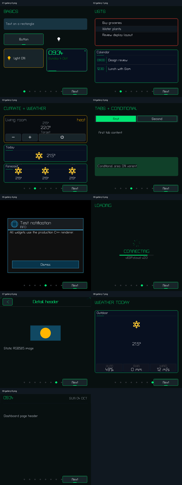

# Production widget gallery

Native 480×480 captures from ESPHome 2026.7.1's SDL host display.
Fixture implementation: `simulator/gallery-app.h`.



| Capture | Production widgets shown |
|---|---|
| [01](01-gallery-0.png) | Label, rectangle, button, icon, light-state toggle, digital clock |
| [02](02-gallery-1.png) | Todo list and calendar list |
| [03](03-gallery-2.png) | HVAC, compact weather, forecast weather |
| [04](04-gallery-3.png) | Tab container and conditional-area composition |
| [05](05-gallery-4.png) | Notification overlay |
| [06](06-gallery-5.png) | Loading widget |
| [07](07-gallery-6.png) | Static image and detail header |
| [08](08-gallery-7.png) | Full weather widget |
| [09](09-gallery-8.png) | Dashboard page header |

Page indicators and navigation buttons are also present. The clock/date uses
host time, and loading animates; those screenshots are illustrative rather than
deterministic golden baselines. Data is local fixture data. Gallery pages invoke
the actual production widget classes directly to include widgets beyond the
current manifest compiler's supported subset. Conditional areas are compositions
of existing widgets, matching the generated firmware approach.

Schema-only types without a C++ renderer (slider, gauge, procedural icon and
auto-layout list) cannot yet produce firmware screenshots.

## Reproduce locally

From the repository root:

```sh
bun run simulator/generate.ts --gallery
docker build -t vesp-gallery-check simulator
docker run --rm --init -d --name opencode-gallery-test -p 127.0.0.1:6086:6080 vesp-gallery-check
SIMULATOR_URL=http://127.0.0.1:6086/ GALLERY_OUTPUT=simulator/screenshots/gallery python3 simulator/capture-gallery.py
docker stop opencode-gallery-test
```

Wait for `/health` to return 200 before capturing. The capture script checks
readiness and each active page index, and verifies navigation wraps to page zero.
Open `http://127.0.0.1:6086/` while running to inspect or interact with the pages.
Run `bun run simulator/generate.ts` afterward to restore ordinary demo build inputs.
This workflow does not deploy or update the public simulator.
